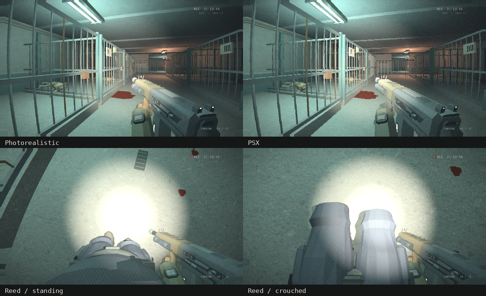

# FEVER — Design and engineering

**One officer. One night shift.** Reed starts the shift at 21:13 with a missing-person call at a county-leased laboratory. The game belongs to the moments when a partner sees something before Reed does, and Reed must decide whether to follow, intervene or listen. The camera at Reed's chest is the eyewitness record. The sound recording lets the player feel what it was like to stand there.

This edition finishes the first call, **Relay Six**. It ends when Reed makes a report to dispatch. “Call filed” advances the story of the shift. The town, roofs and subsequent calls from the earlier web game are material for later chapters. The portable edition runs as a native Windows desktop game.

## Playing the opening

| Beat | What the player can do | What makes the scene advance |
| --- | --- | --- |
| County aircraft | Look around the red-lit cabin as the flood cuts off the road below. Dispatch has a single custodian on the books. | The crew descends in sequence. The recording continues through touchdown. |
| Service intake | Follow Cole to the door or linger outside. Watch a teammate inspect a time clock. | Cole operates the panel. Reed crossing the doorway starts the interior beat. |
| Holding pens | Walk either side of the central aisle. Point the lamp through the bars. Read the animal stop order, the override and the exposure log mounted in the building. | Passing the middle pens wakes one occupied cage. The other animals and equipment were present on entry. |
| Kennel incident | Trace the appendage to the dog, step out of reach or shoot it. Bell and Cole turn to the moving threat and can drive it back themselves. | Damage makes the appendage visibly retract before the squad moves deeper. The dog stays behind its bars. |
| Isolation | Arrive ahead of the medic or hang back. Observe the person on the floor, the medic's hands near the patient and the transfer to her sleeve. | Ives must reach the patient's side and Reed must be near enough to witness the examination. The host turns on the nearest available target. |
| Report | Intervene, fall back behind the crew or get hurt. Move to the wall set after the attack. | Reed transmits the report. Dispatch acknowledges it. Death ends the recording and offers a checkpoint retry. |

The ethics of the institution show up in mundane objects. A written stop order and the still-connected pump can coexist in the same shot. The viewer can work out what someone authorized before the parasite moves. No waypoint points out the answer.

## Runtime decision

**C++17 owns the complete runtime.** Win32 handles windowing and raw mouse input, XInput handles the pad, D3D11 renders original HLSL, WIC decodes images on load, and a native mixer writes stereo PCM to the Windows audio device. The portable package contains the compiled game, models, texture sheets, shaders, tuning and cue sheet. A developer can trace a door crossing from input to sound and pixels in this repository.

| Option considered | What it buys | Cost for this game | Decision |
| --- | --- | --- | --- |
| Native C++ with a narrow data layer | One owner for state, timing and allocation. Artist parameters, lines and assets can change independently. | A genuinely new behavior needs a compile. The team owns its tooling. | Ship this. F5 validates a complete tuning table and installs it atomically. |
| Embedded JavaScript / V8 | General-purpose authored code and quick custom events. | VM packaging, garbage-collection timing, native-handle lifetimes, save compatibility and a second debugger. | Revisit when several calls require repeated mission-code changes that typed event records cannot express. |
| Node or Electron runtime | Familiar web tools and existing JS imports. | Additional processes and runtime dependencies duplicate services FEVER already owns. | Use Node only as an optional offline model cooker. Players launch the EXE directly. |

The 90 Hz simulation owns positions, checkpoint state, aim, hit queries and tagged sound events. Rendering reads that state. The audio worker owns filtering and playback. Cue IDs identify speech, actors identify spatial emitters, and material IDs identify surfaces. Script authors never need a renderer or audio-device pointer. If scripting earns its keep later, expose read-only facts and a bounded queue of typed requests at simulation boundaries. Keep movement and visibility evaluation native. [V8 embedding guide](https://v8.dev/docs/embed)

## Making the image feel recorded

**Footage reference.** In the Grass Valley rescue recording, look at the porch and doorway around 00:40–00:55, then the arm crossing the lens around 01:35–01:55. A close edge takes over much of the image when the officer leans into the doorway. The time overlay stays registered to the screen. Preserve the relative motion of frame, arm and lettering. Different devices and mounts produce different pictures. The NIJ equipment guide describes the tradeoff between a wide view and useful detail at its edges. [Released recording](https://commons.wikimedia.org/wiki/File:Bodycam_Shows_Police_Officer_Saving_Man_From_Burning_House.webm) · [NIJ equipment research](https://nij.ojp.gov/topics/articles/research-body-worn-cameras-and-law-enforcement) · [Axon recording settings](https://www.axon.com/help/axon-body-2/cameras-and-sensors/body/settings.htm)

**Developer references.** Reissad described combining densely dressed scenes with simple optical degradation, including a fisheye material and a border in front of the camera. Liam Fleming's recreation studies how a mount overlaps a turn and settles afterward. Unrecord describes independent aiming and how the arms relate to the camera. Deppart is a useful small-team reference for walking toward a lit opening in the dark. FEVER takes the camera and staging lessons into a forward renderer whose costs we can count. [Reissad interview](https://80.lv/articles/developing-a-game-with-realistic-graphics-in-unreal-engine) · [Fleming's camera study](https://www.innovecsgames.com/blog/bodycam-effect-games/) · [Unrecord](https://store.steampowered.com/app/2381520/) · [Deppart](https://n4ba.itch.io/deppart)

**Camera and aim.** Put the mount 1.43 m above level ground. Follow a torso target with six analytic spring axes. Give the arms their own response. Walking distance advances the stride, a landing kicks the mount, and turning produces a little roll. Base horizontal FOV is 105°, narrowing toward 86° while aiming. Hits use the player's intended direction through the chest viewpoint. Cap rotational separation so a quick turn stays playable. Reduced Motion removes most displacement and increases settling speed. Lens distortion and sensor grain have their own switches.

| Stage | Photorealistic | PSX |
| --- | --- | --- |
| Scene and geometry | Native window resolution, detailed close meshes, texture mips and anisotropic sampling. | Internal height up to 300 pixels at the current aspect ratio. Lower-detail actors and equipment. Snap projected vertices in clip space. |
| Light | Eight local practicals, a shadow-casting live flashlight, a brief dynamic firing light, material-dependent highlights and atmospheric falloff. | The same lamp positions, flashlight, muzzle flash and occlusion preserve the location of clues. |
| Surface | Tiled albedo and small-scale normals. A packed map controls roughness and cavity. A wet floor, rubber tile and painted enamel react differently as the lamp crosses them. | Simpler surface evaluation leaves more silhouette and light-value contrast at the lower pixel density. |
| Exposure and lens | A GPU-only 5×5 luminance meter adapts at about 30 Hz. One full-screen pass handles radial warp, edge-weighted color separation, highlight rolloff, vignette, exposure-dependent noise and sparse bright-light lens flecks. | Nearest-sample the low-resolution image, quantize to 5 bits per channel and apply a 4×4 ordered dither. Grain and lens settings remain available. |
| Interface | Composite stable, native-resolution captions and recording metadata after the lens pass. | Same clean lettering and controller-driven PlayStation-inspired menu. |

An orange room lamp, a red kennel tag and a muzzle flash can all be bright for different lengths of time. The exposure meter has a faster response going into light and a slower recovery going back into darkness. Reducing the gain on the entire display to hide weak materials would also erase the timing of those events. Photorealistic is the name of the preset and the visual target. The current art uses authored geometry and tiled materials.

## Sound at Reed's chest

**A loud sound produces one overload effect.** The crack catches, then the whole recording loses treble and level. A low-level pitched ring briefly sits in that same mix. The space around Reed returns as the effect releases. The player hears the microphone convey the officer's experience. A door only changes how much sound arrives at Reed. A teammate firing beside Reed in the kennel can wash out the cage rattle for a moment. The same teammate behind the shut intake door sounds duller at the outset and barely disturbs the other sounds.

The [six-second audio comparison](media/kennel-door.flac) comes directly from the game mixer. Listen for the footsteps under the shot at **0.60 seconds**, then for the same steps and shot at **3.60 seconds**. Source position, listener, gain and playback level match. The intake door closes for the second take.

| Order | Runtime behavior |
| --- | --- |
| 1. Emit | World events retain their origin. A recorded line follows its speaker as the actor moves. Reed's clothing sits at the chest. Dispatch uses a narrow radio channel with a small amount of static. The device mixes 32 concurrent sources at 48 kHz stereo. |
| 2. Propagate | Pan toward the emitter or the first opening along the room path. Attenuate by distance. Test the direct segment against concrete, glass, steel barriers and fabric. Compare direct transmission against a route through connected openings. A closed metal entrance strongly reduces gain and high frequencies. Values are artistic approximations. |
| 3. Return from the room | The yard has a short, weak return. The kennel aisle feeds more energy back over two unequal stereo delays. The cabin and rooms use intermediate values. Reflections, rotor vibration, pace-dependent rustle, movement wind and stress thumps share the mix. |
| 4. Respond to loudness | For a sharp event, use its level at Reed **after propagation**, its high-frequency content and how enclosed the room is. A single bounded envelope drives brief saturation, muffling and ringing. Its short attack preserves the initial crack. Repeated shots refresh the same envelope. Full-strength recovery defaults to 0.85 seconds. |
| 5. Deliver | Apply the output level and soft peak control. Night Range compresses peaks for quieter playback. Captions and master volume remain usable through an encounter. |

**Listening references.** The public Grass Valley file is already encoded. In a mono analysis copy of that release, 10-second windows starting at 01:00 and 01:50 had approximate RMS levels of −40 and −29 dBFS respectively. These are observations from that file, useful for hearing the distance between quiet passages and sudden close events. They are unsuitable as microphone calibration data. A published Lilburn rescue also illustrates how breathing and speech can overlap and mask each other at a doorway. Reissad's audio devlog and Steam Audio's transmission and occlusion documentation inform the game treatment. Our inexpensive portal and filter model runs in the native mixer. [Grass Valley footage](https://commons.wikimedia.org/wiki/File:Bodycam_Shows_Police_Officer_Saving_Man_From_Burning_House.webm) · [Lilburn footage and account](https://www.cbsnews.com/atlanta/news/police-bodycam-captures-dramatic-rescue-attempt-during-deadly-gwinnett-home-fire/) · [Bodycam audio devlog](https://www.youtube.com/watch?v=Oz66Ek1RYWU) · [Steam Audio spatializer](https://valvesoftware.github.io/steam-audio/doc/wwise/spatializer.html)

**Voice production.** The [recording script](DIALOGUE.md) is both the human-readable script and the game's cue table. It contains every line, its trigger, delivery, route and minimum caption duration. A missing recording produces silence and a caption. A supplied take extends the cue to its actual duration. Only one line plays at a time. Urgent cues can interrupt an observation. Gunfire, cloth, steps, cage impacts, parasite motion and the radio carrier already work. The edition ships with zero spoken recordings.

## Squad and creature behavior

Cole is drawn to locks and access points, Ives to evidence of treatment, and Bell to records and equipment. Each interest identifies where the actor can stand and what to look at. An actor inspects once, looks up from the work if threatened, then resumes the group's route. Separate high and low distance thresholds let a stationary player watch an ally wait without making them step forward and back. A player running ahead triggers a catch-up gait. Local avoidance lets partners pass instead of walking to the same spot.

Movement takes a direct collision-checked path whenever possible. A blocked route starts a four-neighbor search at 0.58 m spacing. The next waypoints are shortened only across clear swept segments. Decisions are staggered, while acceleration, movement and hit reactions continue at the simulation rate. In combat the host can pursue a visible target or investigate a recent sound attenuated by the same geometry that affects Reed. The human examination and the change in the medic remain authored events. [Buddy AI in The Last of Us](https://www.gameaipro.com/GameAIPro2/GameAIPro2_Chapter35_Ellie_Buddy_AI_in_The_Last_of_Us.pdf) · [Systems and tools research](ENGINE-RESEARCH.md)

## First-person presence and animation

Reed's world position anchors a pelvis, two independently planted feet and a chest mount. Thighs, lower legs, boots, belt, coat and equipment occupy world space. The upper silhouette contributes to the shadow pass. While a foot bears weight its horizontal location holds. The next foot swings to a velocity-predicted point. Two-bone inverse kinematics bends the knee toward the body's forward direction. Crouch lowers the pelvis while the boots stay on the floor. Airborne feet lift with the body. The hips tolerate a small standing turn before following the chest. Looking down moves the carried prop slightly aside. The world controller uses a padded footprint against the current floor and obstacles. The opening contains no stairs.

The prop and hands have compatible authored poses for aimed hold, two phases of reload or melee, a moving mechanism and a grip adjustment. The GPU blends the poses. Reed also breathes, shifts his carry while running, settles after landing and occasionally readjusts after a long idle. Aiming or moving suppresses the idle gesture. The rifle and sidearm have different reload clocks. An empty reload takes longer than a partial one. The visual insert and the change to inventory share a timed event. Switching before that event preserves the previous magazine. Switching afterward preserves the transferred rounds. Each new action begins with its own phase. Check contact points both at full landmark poses and halfway through their blend.

The higher-detail crew uses authored gait, action and reaction poses. Travelled distance drives footfall sounds. Ives lowers into her examination when she reaches the patient. Separate attack and recoil weights keep the kennel creature responsive. The captured poses are a useful format for this small cast. A production skeletal library makes more sense once several new human performances must share rigs and retargeting. [DICE on the full-body camera](https://www.ea.com/amp/news/the-world-from-faiths-perspective) · [Halo first-person pose families](https://learn.microsoft.com/en-us/halo-master-chief-collection/h2/art/animation/animationsfpanims) · [Bungie on first-person animation](https://gdcvault.com/play/1022297/The-Art-of-First-Person)

## Asset and material production

| Asset | Close triangles | Low-detail triangles | Where detail matters |
| --- | ---: | ---: | --- |
| Carbine with hands and field recorder | 8,550 | 1,563 | Collar silhouette, the front glass, woven equipment and relief on the checkered housing |
| Sidearm with hands and field recorder | 5,394 | 1,309 | Slide profile, changes of finish and the shape of the supporting hand |
| Cole | 8,578 | 1,040 | Face, jacket folds, duty gear and the recording unit attached to his chest |
| Ives | 7,878 | 1,087 | Distinct uniform, gloved hands near the patient, contrasting shoulder markings |
| Kennel hound | 2,812 | 1,354 | Body profile behind the bars and the sudden change in posture |

These are counts from the cooked indexed meshes. The first-person totals include hands and attachments. A budget for a bare prop has to be evaluated separately. The proposed 8–18k for a high-detail long arm and 4–10k for a sidearm are working targets for the next art pass. A triangle is worth adding if it changes a visible contour, deformation or glancing highlight in our camera. A universal texel-density number would tell us little about a prop clipped by the recorder's edge. Measure the closest intended framing and allocate UV space to the surfaces it actually shows.

**Authoring order.** Gather front, side and three-quarter finish references. A museum object can establish what aged rubber, worn paint and a lens collar look like. Block out the silhouette and negative spaces. Round important edges in geometry, preserve separate moving pieces and compare in the game lens. For hand-sculpted replacements, bake shallow markings, bevel normals and occlusion from the dense source. Inspect an angled flashlight sweep over the complete action at both LODs. The current kit is editable procedural art and uses tiled surface response. Unique sculpt bakes are a next production step. [Smithsonian flashlight reference](https://americanhistory.si.edu/collections/object/nmah_1437373) · [Adobe baking](https://experienceleague.adobe.com/en/docs/substance-3d-painter/using/baking/baking) · [Artist's weapon art workflow](https://80.lv/articles/3d-weapon-art-workflow)

**Material contract.** Seventeen rows in the [material table](../assets/materials.tsv) define the shared tile, its scale, perceived roughness, metal fraction, normal strength, specular weight and emission. A wet organic surface has a broad, dark base with a strong highlight. Painted enclosure rails take a smaller highlight. Cloth responds with broad diffuse light and subtle weave. All three use the same foreground flashlight. The label sheet preserves unique text. Emissive surfaces have separately authored nearby light sources. This is a tuned forward shading model.

The cooker produces eight 256×256 tiles in each of two Direct3D texture arrays. Albedo uses BC1. The response array uses BC3 with roughness in R, the X normal slope in G, cavity in B and the Y slope in A. Each tile has its own nine offline-generated mip levels and cannot bleed into another tile at distance. The two GPU payloads total **1,048,896 bytes** before driver alignment. Equivalent RGBA8 mip chains require **5,592,384 bytes**. That is an **81.2% reduction for those two texture arrays**. The UI, HDR render target, shadow map and model memory have their own costs. [Insomniac's reusable trim workflow](https://www.gdcvault.com/play/1022323/The-Ultimate-Trim-Texturing-Techniques) · [Filament material reference](https://google.github.io/filament/main/filament.html)

## Performance and verification

- **Cull and reduce work first.** Group the building by room and kennel wing. Reject irrelevant sectors, then test conservative projected bounds against the camera or flashlight frustum. For actors and animals, project the size of the bounding sphere using distance, FOV and render width. Switch down below about 62 reference pixels and return to the close mesh above 88. A stable per-actor choice prevents oscillation. The same camera selection is used for its shadow. Nearby photographic equipment keeps its close mesh. PSX uses authored low variants immediately.
- **Keep geometry and texture traffic small.** GPU base vertices occupy 24 bytes. A moving model gets a separate 40-byte packed motion stream. Static meshes use one repeated zero record. Meshes that fit use 16-bit GPU indices. Material arrays are bound once for the world pass. Restrict the flashlight to one 768² shadow map and build the lens image in a single full-screen pass. A fixed pool of 112 particles caps bursts of sparks, fluid, dust and fibres. New effects reuse existing slots.
- **Keep time budgets observable.** F3 shows measured frame duration, mean FPS and the 95th percentile of up to 120 frames. F5 reloads valid tuning. Running `FEVER.exe --benchmark` writes a paired 1080p hardware report with Direct3D timestamp queries, CPU simulation time and draw submission time. The Windows workflow exercises the real D3D11 pipeline with Microsoft's WARP driver and captures both presets plus the visible body. This checks program, resource and draw compatibility. Hardware is selected for ordinary play. The previous browser report's 9 FPS came from a different Canvas CPU fallback after a WebGL link failure.
- **Working targets, pending physical hardware.** Test 1080p Photorealistic and 1080p output PSX on a Vega 8-class dual-channel integrated GPU, targeting 60 FPS, p95 ≤18 ms and p99 ≤25 ms after warm-up. On a UHD 620-class laptop, also record 1080p Photorealistic at a 30 FPS target and PSX at 60. Publish the adapter, driver, resolution, CPU, memory configuration and cold-entry hitch before setting minimum specifications. Budget 3 ms for simulation and draw preparation, 12 ms GPU time and under 3 ms per 10.7 ms audio block. CPU, GPU and audio work overlap.
- **Regression checks.** The incident test walks from arrival to a filed report, forces death and restore, checks patrol spacing, navigation around a desk, crew defense and a player hit on the lash. It also checks stance and floor contact, reload cancellation on either side of the ammo event, LOD hysteresis, spatial sound, silence when a take is missing, timing and panning for a supplied take, and the single overload response through a door. The asset audit checks every mesh payload and counts the compressed mips.

## Continuing the shift

| Future call | What carries forward | First technical question |
| --- | --- | --- |
| Suburban house | Partner leads, occult basement, living matter and destructible clutter | Can the player and host associate movement and sound with the correct floor? |
| Snow forest | Light-averse Grey, patient observation, abduction and rescue | Can a far silhouette survive mip transitions, fog and exposure without flicker? |
| Christmas office | Prop possession, UV and capture, noisy office devices | How many awake objects and lights can a room afford while both ghosts and furniture remain legible? |
| Distress call at the farm | A flock that escalates, indoor birds, barn encounter | Can distant and attacking birds share movement and damage events at two levels of simulation? |
| Hospital | Guard a survivor while a persistent figure enters and leaves view | Can the pursuer remember a sound and take a different route without gaining perfect knowledge? |
| Caves | A giant spider follows a team across irregular surfaces | Can independently planted feet find walls and ceilings while the body stays coherent and recognizable? |

Each later call must reach a report, an extraction or a player failure and feed the same night-shift record. Their playable web predecessors remain useful references. Only Relay Six is playable in this desktop release. The [comparative engine study](ENGINE-RESEARCH.md) gives the source, tradeoff and acceptance test behind each proposed technology.
